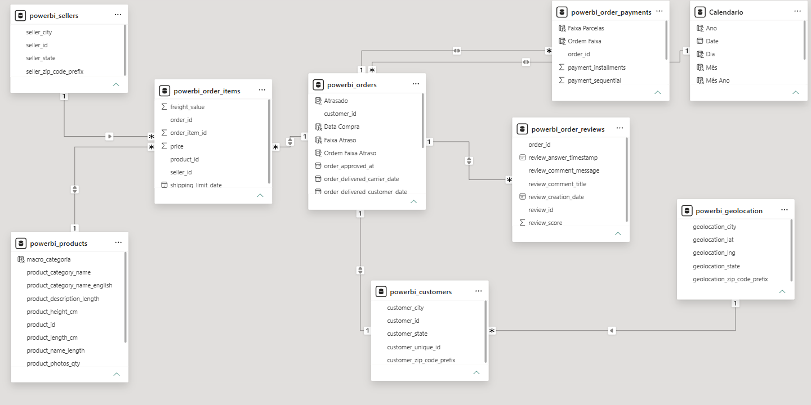
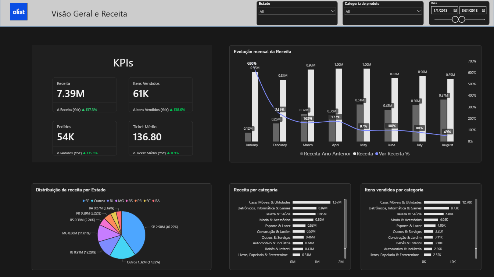
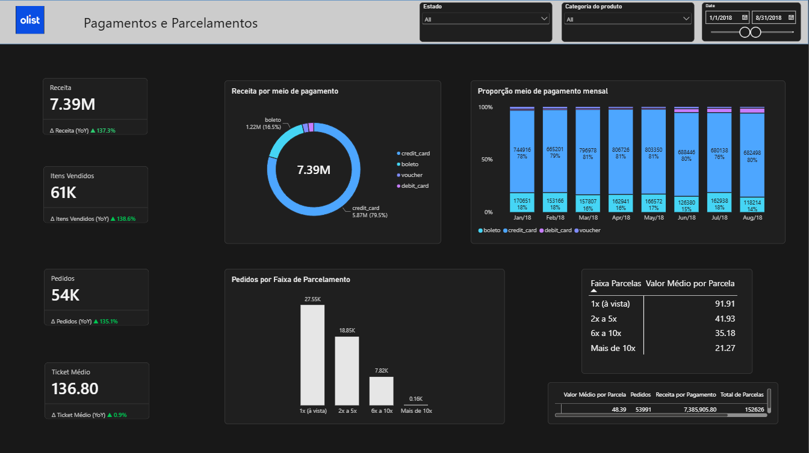
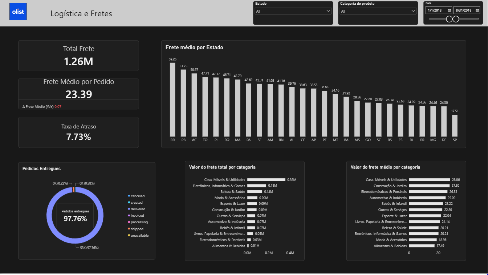
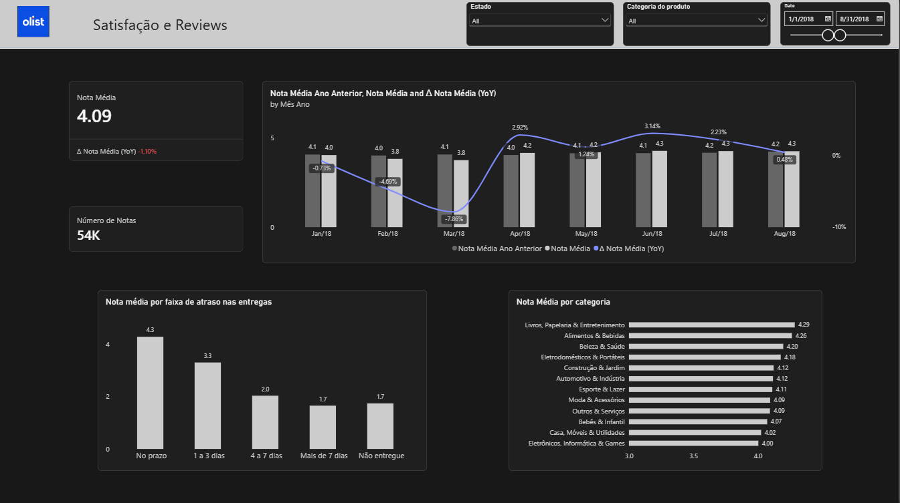
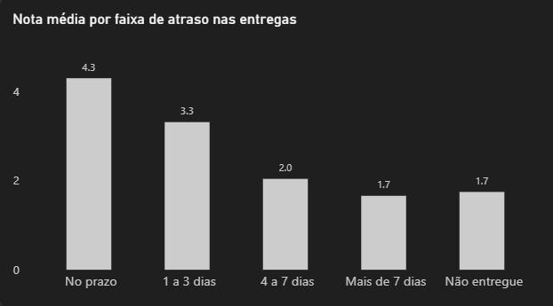
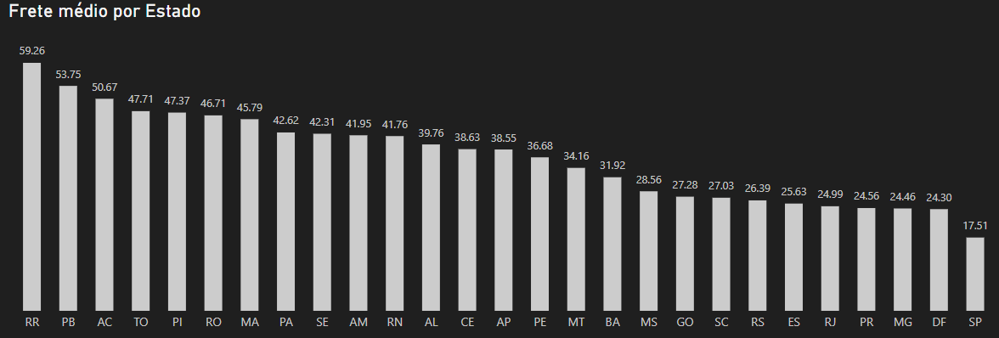
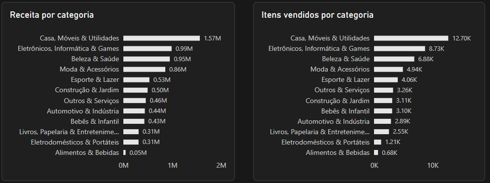
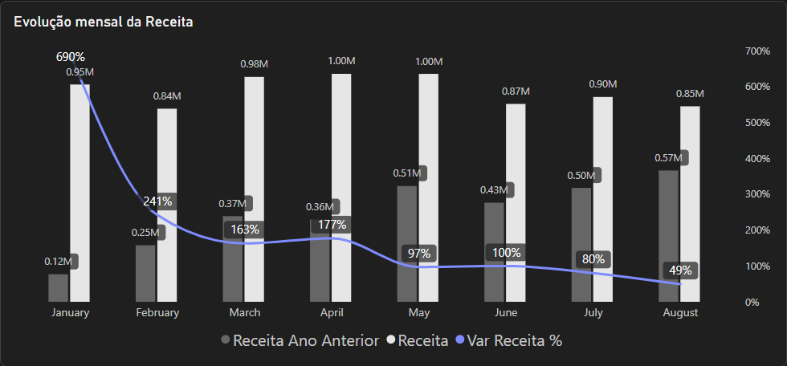
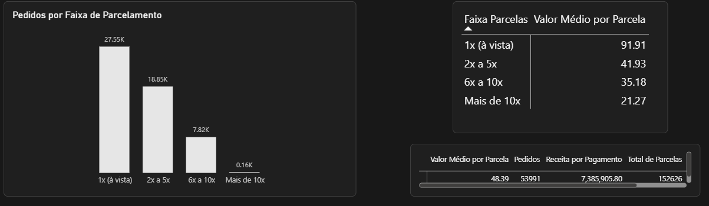

# Projeto Power BI — Dashboard de Vendas no E-commerce

Este é um dos projetos do repositório [Olist E-commerce](https://github.com/yuji0ka/Olist-E-commerce), um agrupamento de projetos de dados e machine learning sobre a base pública da Olist. Cada projeto tem sua própria pasta, tabela gold e notebooks. Para ver todos os projetos, acesse o repositório completo: https://github.com/yuji0ka/Olist-E-commerce

Projeto de Business Intelligence para analisar as vendas do marketplace da Olist, transformando os dados em dashboards interativos para acompanhar a situação do negócio, monitorar os principais KPIs e extrair insights. O projeto percorre o pipeline completo: limpeza dos dados (gold), modelagem das relações entre tabelas no Power BI, criação de medidas DAX e a apresentação dos resultados em um dashboard.

## Palavras-chave

`Business Intelligence` `Power BI` `DAX` `Star Schema` `Modelagem de Dados` `Dashboards` `KPIs` `Data Visualization` `E-commerce` `Olist` `Medallion Architecture` `Delta Lake` `PySpark` `Databricks` `Unity Catalog` `YoY`

## Pipeline

1. Definição do problema de negócio
2. Limpeza e preparação dos dados (notebook `03_gold`)
3. Modelagem do banco relacional (8 tabelas, modelo estrela e relacionamentos no Power BI)
4. Criação das medidas DAX para KPIs, análises e simplificação de categorias 
5. Elaboração dos dashboards (gráficos, indicadores, cores)
6. Interpretação e principais insights
---
## 1. Definição do problema de negócio

Muitas empresas de e-commerce não monitoram dados estruturados e costumam tomar decisões “no achismo”. Faltava um painel único para acompanhar produtos, pagamentos, pedidos, avaliações, vendedores e vendas, com metas e comparação entre períodos.

A ideia é ter todas as principais métricas acessíveis e sempre comparar os resultados com o mesmo período do ano anterior (YoY) para tirar a sazonalidade. No nosso projeto, os gráficos mostram o período de 01/01/2018 até 31/08/2018 (última data disponível), e fazem o comparativo direto com o mesmo período de 2017.

## 2. Limpeza e preparação dos dados
### Plataforma — Databricks e a Arquitetura Medallion

Este projeto foi desenvolvido no **Databricks**, uma plataforma de dados que me permite controlar, tratar e organizar os dados para diferentes tipos de projetos. Todos os dados da Olist passam por um pipeline único, compartilhado entre os projetos do repositório, seguindo a **Arquitetura Medallion**:

- **Bronze** — os 9 CSVs originais da Olist são carregados como tabelas Delta no Unity Catalog, preservando os dados brutos exatamente como chegaram.
- **Silver** — os dados são limpos, tipados e deduplicados (checagens de nulos, duplicados e integridade referencial), formando uma base confiável e padronizada.
- **Gold** — etapa final antes do consumo pelo projeto: as tabelas silver recebem os tratamentos específicos deste projeto e são salvas como `olist.gold.powerbi_*`, prontas para a modelagem no Power BI.

Essa separação em camadas garante que cada projeto consuma a mesma base limpa, sem retrabalho, e que qualquer novo projeto possa ser construído em cima da silver sem afetar os demais.
### Fonte dos dados

Base pública da Olist no Kaggle: https://www.kaggle.com/datasets/olistbr/brazilian-ecommerce

Foram usadas as 8 tabelas da camada silver (`olist.silver.*`). Antes de criar as tabelas gold específicas para o Power BI , cada conjunto de dados passou por verificações e tratamentos:

| Tabela         | Problema identificado                 | Tratamento aplicado                      |
| -------------- | ------------------------------------ | ---------------------------------------- |
| geolocation    | 981 mil duplicatas de CEP            | Agrupado por CEP (média lat/lng)         |
| order_payments | 3 linhas com payment_type = not_defined | Removidas                               |
| order_reviews  | Muitos nulos em título/mensagem      | Preenchido com 'Sem comentario'          |
| orders         | Nulos em datas de entrega            | Mantidos (esperado para não entregues)   |
| products       | Sem categoria/dimensão em alguns casos | Preenchido com 'sem_categoria'/mediana  |
| customers      | Sem nulos                            | Nenhum tratamento necessário             |
| order_items    | Sem nulos                            | Nenhum tratamento necessário             |
| sellers        | Sem nulos                            | Nenhum tratamento necessário             |

Após os tratamentos, todas as tabelas foram salvas em formato gold, prefixadas como `olist.gold.powerbi_*`. Esses dados limpos e organizados são a base para toda a modelagem e visualização no Power BI.

## 3. Modelagem do banco relacional

O modelo relacional foi estruturado com 8 tabelas principais, seguindo um formato estrela (“star schema”) clássico de BI. Cada tabela doravante traz campos relevantes e é utilizada para garantir relações simples e eficientes entre fatos e dimensões no Power BI. 

- **Tabelas de fatos e dimensões:**
    - `powerbi_orders`, `powerbi_order_items` e `powerbi_order_payments` funcionam como fatos principais para análise de pedidos, itens e pagamentos.
    - As dimensões — `powerbi_customers`, `powerbi_sellers`, `powerbi_products`, `powerbi_order_reviews`, `powerbi_geolocation`  enriquecem os fatos com contexto (cliente, vendedor, produto, avaliação, localização).
    

Os relacionamentos são todos construídos via chaves primárias e estrangeiras explícitas (ex: `customer_id`, `product_id`). Isso permite flexibilidade e integração total no Power BI, facilitando a criação de medidas DAX e dashboards robustos.

## 4. Criação das medidas DAX para KPIs, análises e simplificação de categorias

Para tornar as análises mais objetivas e relevantes, realizei simplificações em algumas categorias — por exemplo, na de produtos, reduzi de 74 para apenas 12 grupos principais. Isso tornou os dashboards mais claros e focados no negócio.

Além dessa etapa, elaborei diversas medidas DAX para KPIs essenciais, possibilitando análises profundas e acionáveis, alguns ex:
- **Receita:** soma total do valor dos pedidos (faturamento).
- **Valor do frete:** soma total dos valores cobrados de frete em todos os pedidos.
- **Número de pedidos:** contagem de pedidos efetuados no período analisado.
- **Número de avaliações:** total de reviews recebidos, medindo engajamento e satisfação.
- **Quantidade de formas de pagamento:** diversidade de métodos usados, útil para análise de comportamento do cliente.
- **Taxa de atraso nas entregas:** percentual de pedidos com data de entrega posterior à prevista, indicando eficiência logística.

Essas medidas permitiram criar visualizações detalhadas e comparar resultados entre categorias, períodos e perfis de vendedor, gerando insights estratégicos para decisões no e-commerce.

## 5. Elaboração dos Dashboards (gráficos, indicadores, cores)

O projeto conta com 4 dashboards principais, cada um voltado para uma área de análise. Todos possuem filtros de Estado, Categoria do Produto e intervalo de Data para análises dinâmicas:

1. **Visão Geral & Receita**  
     
   Exibe KPIs gerais do negócio, evolução mensal da receita, distribuição por estados e categorias.

2. **Pagamentos & Parcelamento**  
     
   Mostra indicadores sobre meios e faixas de pagamento e parcelamento.

3. **Logística & Fretes**  
     
   Apresenta métricas de frete, pedidos entregues e custos logísticos por estado e categoria.

4. **Satisfação & Reviews**  
     
   Reúne as principais métricas de satisfação do cliente e avaliações, com cortes por período e categoria.

---

## 6. Interpretação e principais insights
as

1. **Atraso do frete impacta diretamente as avaliações**

   O tempo de entrega do pedido é um dos grandes determinantes da satisfação do cliente: quanto maior o atraso, menor a nota. Entregas no prazo têm média acima de 4, enquanto atrasos se traduzem em avaliações cada vez piores.

   

2. **Frete mais barato nos estados do Sudeste, Centro-Oeste e Sul**

   Estados como SP, DF, MG e PR têm fretes significativamente mais baratos, provavelmente devido à concentração de centros de distribuição nesses locais. Estados distantes, como RR, PB e AC, apresentam os maiores valores médios de frete.

   

3. **Receita e quantidade de itens concentrada em algumas categorias**

   A maior parte da receita vem das categorias Casa, Móveis & Utilidades, Eletrônicos & Games, e Beleza & Saúde, que também lideram em quantidade de itens vendidos. Isso mostra o perfil de consumo e oportunidades de foco no marketplace.

   

4. **Receita em alta e forte evolução no período**

   Houve um aumento significativo na receita de 2017 para 2018, com crescimento mês a mês, indicando maturidade comercial e sucesso das promoções sazonais.

   

5. **Compras de maior valor costumam ser parceladas**

   A maioria das vendas ocorre à vista (1x), mas compras de valor mais alto são mais frequentes em maior número de parcelas. Isso mostra a importância de oferecer opções de parcelamento atraentes para ticket médio maior.

   
---
## 7. Conclusão
O projeto atingiu o objetivo de transformar dados brutos do marketplace Olist em dashboards interativos e estratégias acionáveis. Os principais insights extraídos ajudam a direcionar decisões comerciais, operacionais e de atendimento. O modelo pode ser expandido para incluir novos períodos, KPIs ou análises mais avançadas (RFM, churn, forecast etc.).

---

## 📧 Contato
Se você tiver interesse, feedback ou quiser discutir o projeto:

- frankyujioka@gmail.com
- [LinkedIn](https://www.linkedin.com/in/frank-yuji-oka-4140672a1)

