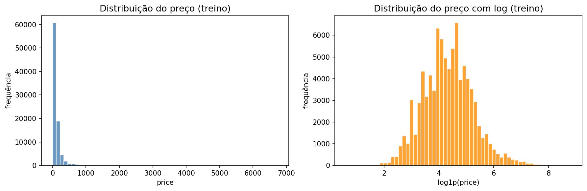
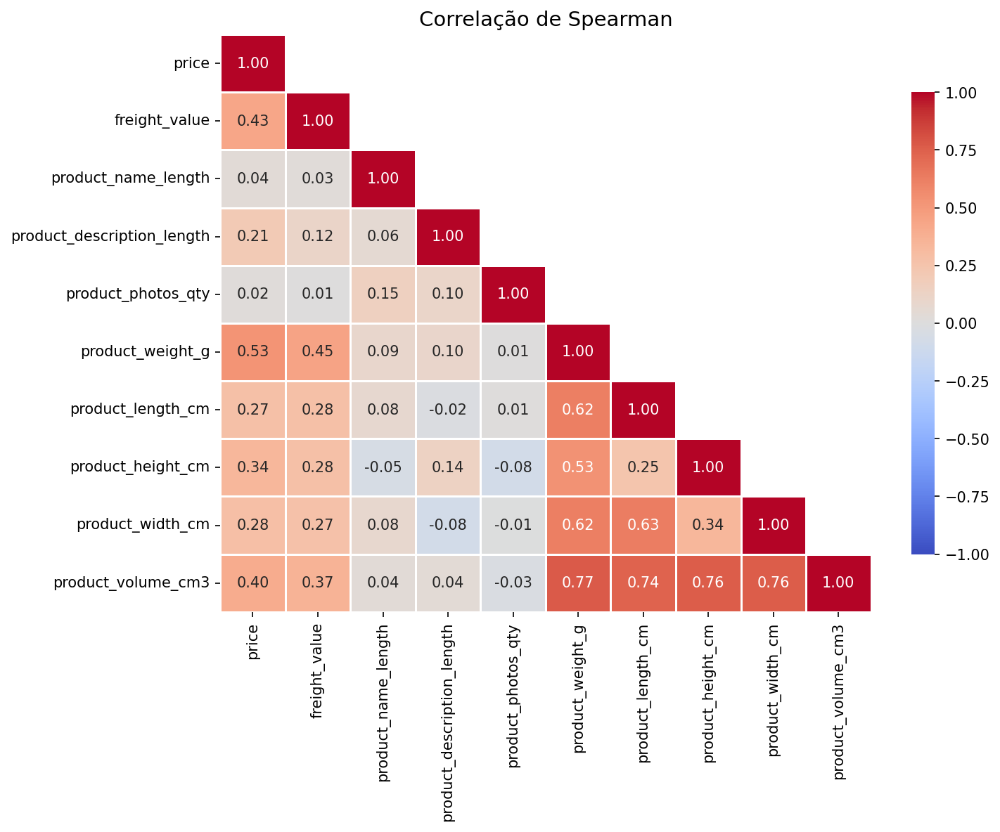
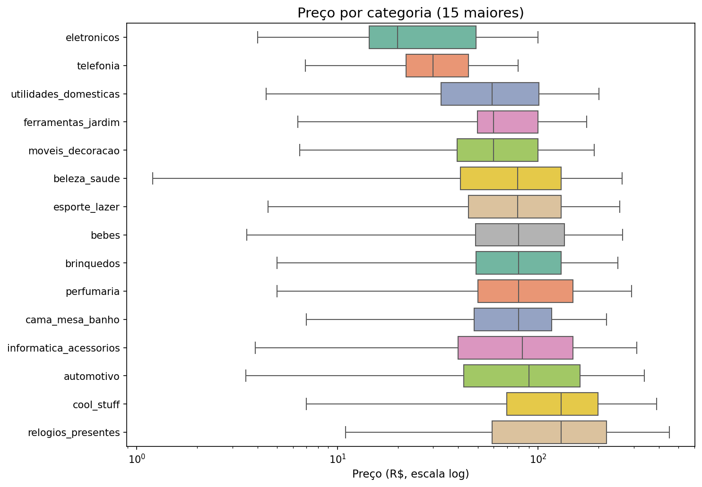

# Projeto Pricing — Previsão de Preços no E-commerce

Este é um dos projetos do repositório [Olist E-commerce](https://github.com/yuji0ka/Olist-E-commerce.git), um agrupamento de projetos de dados e machine learning sobre a base pública da Olist. Cada projeto tem sua própria pasta, tabela gold e notebooks. Para ver todos os projetos, acesse o repositório completo: https://github.com/yuji0ka/Olist-E-commerce.git

Projeto de Machine Learning para estimar o preço de produtos no marketplace da Olist. O projeto percorre o pipeline completo: definição do problema, limpeza dos dados (gold), análise exploratória (EDA) e modelagem.

## Palavras-chave

`Machine Learning` `Pricing` `Regressão` `CatBoost` `XGBoost` `scikit-learn` `Gradient Boosting` `Validação Cruzada Temporal` `TimeSeriesSplit` `Feature Engineering` `EDA` `Medallion Architecture` `Delta Lake` `PySpark` `Databricks` `Unity Catalog` `log1p` `Hyperparameter Tuning` `Overfitting`
## Pipeline

1. Definição do problema de negócio
2. Limpeza e pré-processamento dos dados (notebook `03_gold`)
3. Entendimento do problema e estratégia de validação (notebook `03_gold`)
4. Divisão dos dados em treino e teste (notebook `EDA_pricing`)
5. Exploração dos dados (notebook `EDA_pricing`)
6. Treinamento dos modelos e ajuste de hiperparâmetros (notebook `modelagem`)
7. Teste e avaliação final do modelo (notebook `modelagem`)
8. Interpretação dos resultados e insights de negócio (notebook `modelagem`)

---

## 1. Problema de negócio

Estimar o preço de produtos em um marketplace. A precificação é uma das decisões mais importantes para o negócio, pois influencia diretamente a demanda, a receita e a margem de lucro. O objetivo é desenvolver um modelo capaz de fornecer uma estimativa de preço a partir das características do produto e, ao mesmo tempo, contribuir para a compreensão da dinâmica de preços no marketplace.
## 2. Limpeza e pré-processamento dos dados (notebook `03_gold`)
### Plataforma — Databricks e a Arquitetura Medallion

Este projeto foi desenvolvido no **Databricks**, uma plataforma de dados que me permite controlar, tratar e organizar os dados para diferentes tipos de projetos. Todos os dados da Olist passam por um pipeline único, compartilhado entre os projetos do repositório, seguindo a **Arquitetura Medallion**:

- **Bronze** — os 9 CSVs originais da Olist são carregados como tabelas Delta no Unity Catalog, preservando os dados brutos exatamente como chegaram.
- **Silver** — os dados são limpos, tipados e deduplicados (checagens de nulos, duplicados e integridade referencial), formando uma base confiável e padronizada.
- **Gold** — etapa final antes do consumo pelo projeto: as tabelas silver recebem os tratamentos específicos deste projeto e são salvas como `olist.gold.powerbi_*`, prontas para a modelagem no Power BI.

Essa separação em camadas garante que cada projeto consuma a mesma base limpa, sem retrabalho, e que qualquer novo projeto possa ser construído em cima da silver sem afetar os demais.

### Fonte dos dados

Base pública da Olist no Kaggle: https://www.kaggle.com/datasets/olistbr/brazilian-ecommerce

### Construção da tabela gold

A tabela gold é construída a partir de 4 tabelas da camada silver:

| Tabela silver | O que traz |
| --- | --- |
| `olist.silver.order_items` | Preço, frete, `product_id`, `seller_id`, `order_id` |
| `olist.silver.orders` | Timestamps de compra, aprovação e entrega, `order_status` |
| `olist.silver.products` | Categoria, dimensões (peso, comprimento, altura, largura), texto do anúncio |
| `olist.silver.sellers` | Localização do vendedor (CEP, cidade, estado) |

O join é feito com `left join` sobre `order_id`, `product_id` e `seller_id`, preservando todas as 112.650 linhas de `order_items`.

### Limpeza

1. **Remoção de itens sem categoria** — 1.603 observações (1,42% da base) com `product_category_name` nulo foram removidas. A categoria é uma variável importante para a previsão de preços, a perda de dados é pequena, e todo produto deveria possuir uma categoria.

2. **Remoção de colunas não necessárias** — 9 colunas foram removidas por não existirem no momento de definir o preço:

   | Coluna | Motivo da remoção |
   | --- | --- |
   | `order_id`, `customer_id`, `order_item_id` | Identificadores: não carregam informação de preço e favorecem overfitting |
   | `order_status`, `order_approved_at`, `order_delivered_carrier_date`, `order_delivered_customer_date` | Pós-venda: não existiriam no momento de definir o preço |
   | `shipping_limit_date`, `order_estimated_delivery_date` | Logística do pedido: dependem do pedido e do frete, não do produto |

3. **Remoção de 1 linha com peso nulo** — Uma única linha com `product_weight_g` nulo (e dimensões nulas) foi removida.

### 3. Entendimento do problema e estratégia de validação (notebook `03_gold`)

**Tabela:** `olist.gold.projeto_pricing`
**Dimensão:** 111.046 linhas × 17 colunas

| Coluna | Tipo | Descrição |
| --- | --- | --- |
| `seller_id` | object | ID do vendedor |
| `product_id` | object | ID do produto |
| `price` | float64 | Preço do produto (variável-alvo) |
| `freight_value` | float64 | Valor do frete |
| `order_purchase_timestamp` | datetime64 | Data e hora da compra |
| `product_category_name` | object | Categoria do produto (em português) |
| `product_name_length` | int32 | Tamanho do nome do produto |
| `product_description_length` | int32 | Tamanho da descrição |
| `product_photos_qty` | int32 | Quantidade de fotos |
| `product_weight_g` | float64 | Peso (gramas) |
| `product_length_cm` | float64 | Comprimento (cm) |
| `product_height_cm` | float64 | Altura (cm) |
| `product_width_cm` | float64 | Largura (cm) |
| `product_category_name_english` | object | Categoria em inglês |
| `seller_zip_code_prefix` | object | Prefixo do CEP do vendedor |
| `seller_city` | object | Cidade do vendedor |
| `seller_state` | object | Estado do vendedor |

### Estratégia de validação

Avaliação de `seller_id` e `product_id` como possíveis features:

- **`seller_id`**: 3.035 vendedores únicos. 1.180 com menos de 5 ocorrências. O maior vendedor tem 2.033 vendas. Decisão: manter como feature, pois carrega informação sobre estratégia de preço do vendedor, mas tratar a alta cardinalidade para reduzir overfitting.
- **`product_id`**: 32.341 produtos únicos. 27.569 com menos de 5 ocorrências. O maior produto tem 527 vendas. Decisão: manter como feature, pois o mesmo produto pode ter preços diferentes ao longo do tempo, mas monitorar o overfitting.

---

## 4. Divisão dos dados em treino e teste (notebook `EDA_pricing`)

### Divisão treino/teste

O split é **temporal** (`shuffle=False`, 80/20), respeitando a ordem cronológica:
- **Treino:** 88.836 linhas, de set/2016 a 25/mai/2018
- **Teste:** 22.210 linhas, de 25/mai/2018 a 03/set/2018

A divisão temporal foi escolhida porque o modelo precisa funcionar em períodos futuros, não em um misto de passado e futuro. Foi comparada a proporção de categorias entre treino e teste e a distribuição de preços (percentis), confirmando que os dois conjuntos são comparáveis.

### Feature engineering na EDA

Criadas a partir de `order_purchase_timestamp`:

| Feature | Descrição |
| --- | --- |
| `purchase_month` | Mês da compra (1-12) |
| `purchase_dow` | Dia da semana (0=segunda, 6=domingo) |
| `purchase_week` | Semana do ano (1-52) |
| `purchase_is_weekend` | 1 se sábado ou domingo, 0 caso contrário |

Também criada a feature `product_volume_cm3` = comprimento × altura × largura, que resume as 3 dimensões em um único valor.
### 5. Exploração dos dados (notebook `EDA_pricing`)
### Análise do target (preço)

- **Distribuição:** fortemente assimétrica à direita. Mediana de R$ 74,90, média de R$ 120,20, máximo de R$ 6.735.
- **Log:** com `log1p(price)`, a distribuição fica próxima de um sino, comprimindo a cauda longa.
- **Outliers:** o limite superior do IQR é R$ 277, com 7,5% das linhas acima. Os 10 maiores preços foram validados — corresponde a categorias plausíveis (eletroportáteis, consoles, relógios) com pesos coerentes. Não há indício de erro de cadastro, então os outliers foram mantidos.

### Análise univariada — Numéricas

| Variável | Mediana | Skew | Insight |
| --- | --- | --- | --- |
| `freight_value` | R$ 16,11 | 5,55 | Mais assimétrica. 10,7% outliers. Máximo de R$ 409,68 |
| `product_weight_g` | 700 g | 3,54 | 59% até 1 kg. 14,3% outliers |
| `product_volume_cm3` | 6.900 cm³ | 3,98 | Máximo de 294.000 cm³ |
| `product_photos_qty` | 1 | 1,95 | 50,2% têm 1 foto. Máximo de 20 |
| `product_name_length` | 51 | -0,88 | Única levemente à esquerda |
| `product_description_length` | 594 | 2,06 | Percentil 95 de 2.115 caracteres |
| `purchase_is_weekend` | 0 | — | 77% em dias úteis, 23% no fim de semana |

Nenhuma variável numérica tem valores nulos. Peso e dimensões não têm zeros nem valores impossíveis.

### Análise univariada — Categóricas

| Variável | Cardinalidade | Insight |
| --- | --- | --- |
| `product_category_name` | 73 | Sem dominância. Maior (`cama_mesa_banho`) tem 10,1%. 22 categorias com menos de 100 linhas |
| `seller_state` | 23 | Concentração em SP (71,6%) |
| `seller_city` | 538 | São Paulo 24,9%. Grafias inconsistentes |
| `seller_zip_code_prefix` | 1.884 | 663 prefixos raros (<5 ocorrências) |
| `seller_id` | 2.477 | 995 com menos de 5 vendas. 446 cobrem 80% das linhas |
| `product_id` | 26.078 | 39,1% das linhas são de produtos com menos de 5 vendas |

### Análise bivariada

**Correlação de Spearman com o preço:**

| Variável | Correlação |
| --- | --- |
| `product_weight_g` | 0,53 |
| `freight_value` | 0,43 |
| `product_volume_cm3` | 0,40 |
| `product_description_length` | 0,21 |
| `product_name_length` | 0,04 |
| `product_photos_qty` | 0,02 |

Usou-se Spearman em vez de Pearson porque o preço tem distribuição assimétrica — o Pearson subestima relações não-lineares (peso: 0,34 no Pearson vs 0,53 no Spearman).

**Redundância entre tamanho físico:**
- Volume × peso: 0,77
- Volume × cada dimensão: 0,74 a 0,76
- Peso × dimensões: 0,53 a 0,62

**Peso vs preço:** o preço mediano cresce com o peso (de R$ 29 a R$ 150), mas não é linear — entre 350 g e 1 kg a mediana estaciona. O percentil 10 sobe continuamente (produtos pesados raramente são baratos), mas o percentil 90 oscila muito (4 a 11× o percentil 10).

**Categoria vs preço:** medianas de R$ 19,90 (`eletronicos`) a R$ 130,00 (`cool_stuff` e `relogios_presentes`). Dentro de cada categoria o preço varia 2 a 4× (IQR).

### Conclusões da EDA

- Nenhuma variável isolada explica bem o preço. As correlações mais fortes (peso 0,53, frete 0,43) estão longe de 1,0.
- Peso, volume e dimensões são redundantes entre si.
- `freight_value` só é conhecido depois que o destino do cliente é definido — é questionável usá-lo se o objetivo for precificar antes da compra.
- `product_id` e `seller_id` têm alta cardinalidade e muitos valores raros.
- **44,1% das linhas do teste são de produtos que o treino nunca viu** — o modelo precisa funcionar com base nas características do produto, não na memorização de IDs.
- O `log1p(price)` deve ser testado, pois comprime a cauda e pode ajudar os modelos.

---

## 6. Treinamento dos modelos e ajuste de hiperparâmetros (notebook `modelagem`)

### Bibliotecas

- **CatBoost** (1.2.10) e **XGBoost** (3.4.1) — modelos de gradient boosting
- **scikit-learn** — validação cruzada, métricas, pré-processamento
- **pandas**, **numpy**, **matplotlib**, **seaborn** — manipulação e visualização

### Feature engineering

Repetida da EDA: `product_volume_cm3`, `purchase_month`, `purchase_dow`, `purchase_week`, `purchase_is_weekend`.

### Definição dos feature sets

4 combinações testadas, variando representação do tamanho físico e presença do frete:

| Feature set | Numéricas | Categóricas (comuns) |
| --- | --- | --- |
| `volume_sem_frete` | base + volume | `seller_id`, `product_id`, `product_category_name`, `seller_zip_code_prefix`, `seller_city`, `seller_state`, `purchase_month`, `purchase_dow`, `purchase_week` |
| `volume_com_frete` | base + volume + frete | (mesmas) |
| `dims_sem_frete` | base + 3 dimensões | (mesmas) |
| `dims_com_frete` | base + 3 dimensões + frete | (mesmas) |

O conjunto `volume + dims` foi excluído pois volume = comprimento × altura × largura são correlacionados.

### Validação cruzada com hiperparâmetros padrão

16 combinações testadas: 4 feature sets × 2 modelos (CatBoost, XGBoost) × 2 (com/sem log). Cada combinação com `TimeSeriesSplit` de 3 folds.

**Top 5 (ordenado por val MAE):**

| Feature set | Modelo | Log | MAE Treino | MAE Val | Gap MAE |
| --- | --- | --- | --- | --- | --- |
| dims_com_frete | catboost | sim | 36,47 | 47,65 | 11,18 |
| volume_com_frete | catboost | sim | 37,21 | 48,06 | 10,85 |
| dims_sem_frete | catboost | sim | 36,62 | 48,44 | 11,82 |
| volume_sem_frete | catboost | sim | 37,60 | 48,94 | 11,34 |
| dims_com_frete | xgboost | sim | 27,03 | 49,72 | 22,69 |

Observações:
- **Log sempre ajuda** — CatBoost sem log: MAE ~56-58, com log: ~48. XGBoost sem log: ~77-85, com log: ~50.
- **CatBoost > XGBoost** com hiperparâmetros padrão (menor gap treino-val).
- **Feature sets com frete** foram marginalmente melhores que sem frete (~1 MAE).
- **Volume e dimensões** tiveram desempenho praticamente igual (redundantes).
- A métrica priorizada foi o **MAE** (erro médio absoluto em reais).

### Hiperparâmetro tuning

Os 2 melhores candidatos (CatBoost e XGBoost, ambos com `dims_com_frete` + log) foram ajustados com busca aleatória manual.

**CatBoost** — 15 trials, grid:
- `iterations`: [300, 500, 800]
- `learning_rate`: [0,01, 0,03, 0,05, 0,1]
- `depth`: [4, 6, 8]
- `l2_leaf_reg`: [3, 5, 7, 10, 15, 20]
- `rsm`: [0,7, 0,8, 0,9, 1,0]

Melhores params: `{iterations: 500, learning_rate: 0,1, depth: 8, l2_leaf_reg: 5, rsm: 0,9}`
Val MAE: 47,65 → **44,54** (gap de 15,11)

**XGBoost** — 12 trials, grid:
- `n_estimators`: [200, 300, 500]
- `learning_rate`: [0,01, 0,05, 0,1, 0,15, 0,2]
- `max_depth`: [4, 6, 8, 10]
- `reg_alpha`: [0, 0,1, 1, 10]
- `reg_lambda`: [1, 5, 10, 20]
- `subsample`: [0,7, 0,8, 0,9, 1,0]
- `colsample_bytree`: [0,7, 0,8, 0,9, 1,0]

Melhores params: `{n_estimators: 500, learning_rate: 0,05, max_depth: 10, reg_alpha: 0,1, reg_lambda: 10, subsample: 0,8, colsample_bytree: 1,0}`
Val MAE: 49,72 → **44,44** (gap de 0,10 do CatBoost)

O loop manual foi usado em vez de `RandomizedSearchCV` porque o scikit-learn não consegue clonar o parâmetro `cat_features` do CatBoost.

### 7. Teste e avaliação final do modelo (notebook `modelagem`)

CatBoost escolhido pelo pipeline nativo com `cat_features`. Treinado no treino completo e avaliado em `X_test` (nunca usado antes):

| Métrica | Treino | Teste | Gap |
| --- | --- | --- | --- |
| MAE | 30,47 | 49,38 | 18,92 |
| MAPE | 0,22 | 0,46 | 0,24 |
| RMSE | 106,47 | 147,35 | 40,87 |

Baseline (mediana): MAE de R$ 82,10. O modelo melhora ~40% o MAE e atinge R² ≈ 0,44.

**Amostra de previsões — CatBoost (melhor modelo):**

| Preço Real (R$) | Preço Previsto (R$) | Erro (R$) |
| --- | --- | --- |
| 53,00 | 40,08 | 12,92 |
| 49,90 | 59,12 | 9,22 |
| 149,99 | 435,26 | 285,27 |
| 35,00 | 43,75 | 8,75 |
| 35,00 | 43,75 | 8,75 |
| 28,90 | 29,56 | 0,66 |
| 95,00 | 170,19 | 75,19 |
| 103,90 | 93,93 | 9,97 |
| 58,00 | 30,66 | 27,34 |
| 21,99 | 23,15 | 1,16 |

### Análise do overfitting e experimento sem IDs

O gap treino-teste de 18,92 indica overfitting, causado por:
- **`product_id`**: 26.078 produtos únicos, 44% do teste são produtos novos
- **`seller_id`**: 2.477 vendedores, 995 com menos de 5 vendas

Experimento: mesmo modelo, removendo `product_id` e `seller_id`:

| | Com IDs | Sem IDs |
| --- | --- | --- |
| Train MAE | 30,47 | 32,60 |
| Test MAE | 49,38 | 50,98 |
| Gap | 18,92 | 18,38 |

O gap caiu 0,54, mas o test MAE subiu 1,60 — os IDs causam overfitting, mas também carregam sinal real para os 56% dos produtos conhecidos no teste.

### 8. Interpretação dos resultados e insights de negócio (notebook `modelagem`)

**O modelo está próximo do teto do que os dados permitem.** Todas as intervenções (tuning, feature sets, remoção de IDs, log) mudam o MAE em ±1 a 3 reais. O gargalo não está no modelo, mas na ausência de features preditivas.

Nenhuma variável isolada explica bem o preço:
- Peso (Spearman 0,53), frete (0,43) e volume (0,40) são as mais fortes
- Nome (0,04) e fotos (0,02) quase não têm relação
- Dentro de cada categoria, o preço varia de 2 a 4× (IQR)

 gap entre treino e teste (MAE 30,47 vs 49,38) indica que o modelo se ajusta ao treino melhor do que generaliza. A hipótese inicial era que `product_id` (44,2% das linhas do teste são de produtos que o treino nunca viu) e `seller_id` fossem a causa, por permitirem decorar o preço de cada item.

Resultado do experimento: o gap quase não mudou (-0,54) e o MAE de teste piorou (+1,60). Os IDs, portanto, não explicam o gap. Eles ainda carregam sinal útil, já que o `product_id` só pode ajudar nos 55,8% das linhas do teste com produto já visto. As causas prováveis, não testadas aqui, são a capacidade do modelo (profundidade 8, 500 iterações) e a mudança de composição de categorias entre treino e teste (~16%).

Os ~53% de variância não explicados vêm de fatores fora da base: marca, concorrência, estratégia de margem, reviews, sazonalidade específica e percepção de valor.

**Limitação estrutural:** 44% das linhas do teste são de produtos desconhecidos no treino. Para esses itens, o modelo prevê essencialmente a mediana da categoria.

**Frete como variável:** o melhor feature set inclui `freight_value`, mas o frete só é conhecido após o pedido. Se o objetivo for precificar antes da compra, o feature set sem frete é o correto para produção.

**Para melhorar significativamente seria necessário enriquecer a base com:**
- Conteúdo textual da descrição do produto (não apenas o tamanho)
- Reviews e notas dos produtos e vendedores
- Histórico de preços do mesmo produto ao longo do tempo
- Marca do produto

Esses dados estão fora do escopo da base Olist disponível.

---

## Ordem de execução

1. `03_gold` — cria `olist.gold.projeto_pricing`
2. `EDA_pricing` — análise exploratória
3. `modelagem` — treinamento, tuning e avaliação final

> Pré-requisito: os notebooks `00_setup`, `01_bronze` e `02_silver` (na pasta raiz) já devem ter sido executados.
---

## 📧 Contato
Se você tiver interesse, feedback ou quiser discutir o projeto:

- frankyujioka@gmail.com
- [LinkedIn](https://www.linkedin.com/in/frank-yuji-oka-4140672a1)
